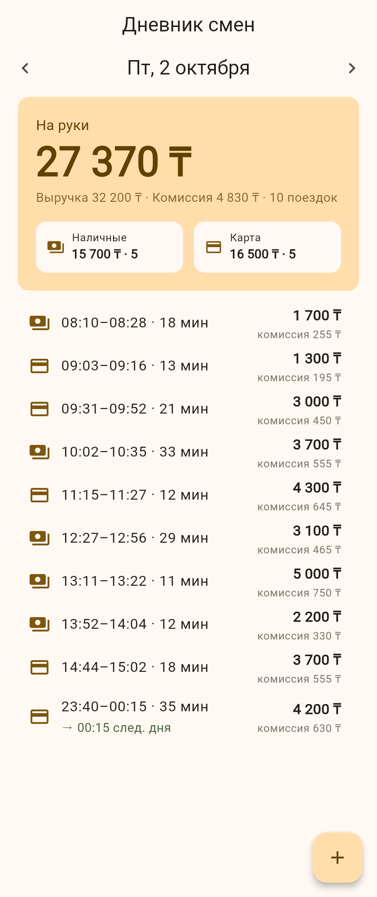
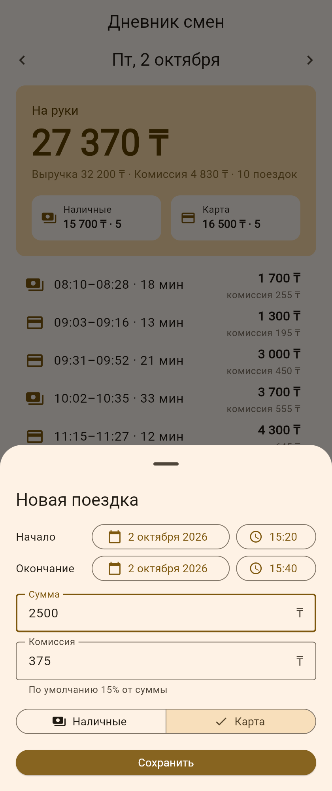

# Дневник смен водителя

Тестовое задание: сервер на FastAPI + SQLite отдаёт поездки и сводку за день, клиент на Flutter (Web, Android) показывает их по дням и позволяет добавить поездку. Повторная отправка той же поездки не создаёт дубль ни на сервере, ни при повторе из клиента после сбоя сети.

| Экран дня | Добавление поездки | Нет связи с сервером |
|---|---|---|
|  |  |  |

## Содержание

- [Требования](#требования)
- [Backend: запуск и тесты](#backend-запуск-и-тесты)
- [Клиент: запуск](#клиент-запуск)
- [API](#api)
- [Чек-лист задания](#чек-лист-задания)
- [Допущения](#допущения)
- [Что можно улучшить](#что-можно-улучшить)
- [Как использовался ИИ](#как-использовался-ии)

## Требования

- **Python 3.11+.** Тесты прогонялись на 3.11.17 и 3.13.16.
- **Flutter 3.47.x** (stable, Dart 3.13). Клиент собран и проверен на Flutter 3.47.7. `pubspec.yaml` требует Dart `^3.13.5`; на более старом Flutter сначала выполните `flutter upgrade`.
- **Chrome** для web-клиента.

## Backend: запуск и тесты

**Windows (PowerShell):**

```powershell
cd backend
python -m venv .venv
.venv\Scripts\Activate.ps1
pip install -r requirements.txt
pytest
uvicorn app.main:app --reload
```

Если PowerShell не даёт запустить `Activate.ps1` («running scripts is disabled»), сначала выполните `Set-ExecutionPolicy -Scope Process -ExecutionPolicy Bypass`. Это действует только на текущее окно.

**macOS / Linux:**

```bash
cd backend
python3 -m venv .venv
source .venv/bin/activate
pip install -r requirements.txt
pytest
uvicorn app.main:app --reload
```

- Сервер: http://localhost:8000, Swagger: http://localhost:8000/docs.
- При старте сервер создаёт `backend/trips.db` и загружает в неё `data/trips.json`. Повторный запуск дублей не создаёт.
- Пути меняются переменными окружения `TRIPS_DB_PATH` и `TRIPS_SEED_PATH`.
- Чтобы начать с чистой базы, остановите сервер и удалите `backend/trips.db`.
- `pytest` запускает 49 тестов: чистую функцию сводки ([`tests/test_summary.py`](backend/tests/test_summary.py)) и API ([`tests/test_api.py`](backend/tests/test_api.py)). Каждый тест работает со своей временной БД.

## Клиент: запуск

Backend должен быть запущен. Во втором терминале:

```bash
cd client
flutter pub get
flutter test
flutter run -d chrome
```

Адрес API задаётся при сборке, по умолчанию `http://localhost:8000`:

```bash
flutter run -d chrome --dart-define=API_BASE_URL=http://192.168.1.10:8000
```

**Android-эмулятор:** с эмулятора компьютер виден как `10.0.2.2`:

```bash
flutter run -d emulator-5554 --dart-define=API_BASE_URL=http://10.0.2.2:8000
```

Для HTTP без TLS в манифесте включён `usesCleartextTraffic`, это допустимо только для локальной разработки. Android-сборку при разработке не запускали, подробности в разделе «Что можно улучшить».

## API

| Метод | Путь | Ответ |
|---|---|---|
| GET | `/api/days` | даты, за которые есть поездки |
| GET | `/api/trips?date=YYYY-MM-DD` | поездки за день, по времени начала |
| GET | `/api/summary?date=YYYY-MM-DD` | сводка за день |
| POST | `/api/trips` | 201 — создана, 200 — такая уже есть, 409 — id занят другими данными, 422 — ошибка данных |
| GET | `/health` | `{"status": "ok"}` |

### Примеры curl

Команды для bash (macOS / Linux / Git Bash). Вывод ниже — реальный, сервер запущен на свежей БД.

Дни с поездками:

```bash
curl -s http://localhost:8000/api/days
```
```json
["2026-10-01","2026-10-02","2026-10-03","2026-10-04"]
```

Сводка за день:

```bash
curl -s "http://localhost:8000/api/summary?date=2026-10-01"
```
```json
{"date":"2026-10-01","trips_count":8,"revenue":25600,"commission":3840,"net":21760,"cash":{"amount":14900,"count":5},"card":{"amount":10700,"count":3}}
```

Поездки за день (`t18` — поездка через полночь 02.10 23:40 → 03.10 00:15, она попадает в 02.10):

```bash
curl -s "http://localhost:8000/api/trips?date=2026-10-02"
```
```json
[{"id":"t9","start":"2026-10-02T08:10:00+05:00","end":"2026-10-02T08:28:00+05:00","amount":1700,"payment":"cash","commission":255,"day":"2026-10-02"},
 ...,
 {"id":"t18","start":"2026-10-02T23:40:00+05:00","end":"2026-10-03T00:15:00+05:00","amount":4200,"payment":"card","commission":630,"day":"2026-10-02"}]
```

Добавить поездку → **201**:

```bash
curl -s -w "\nHTTP %{http_code}\n" -X POST http://localhost:8000/api/trips \
  -H "Content-Type: application/json" \
  -d '{"id":"demo-1","start":"2026-10-05T08:10:00+05:00","end":"2026-10-05T08:32:00+05:00","amount":2400,"payment":"card","commission":360}'
```
```
{"id":"demo-1","start":"2026-10-05T08:10:00+05:00","end":"2026-10-05T08:32:00+05:00","amount":2400,"payment":"card","commission":360,"day":"2026-10-05"}
HTTP 201
```

Та же команда ещё раз → **200**, дубль не создан. Тот же момент, записанный в UTC (`"start":"2026-10-05T03:10:00Z","end":"2026-10-05T03:32:00Z"`), — тоже **200**: это та же поездка.

Тот же id, другие данные → **409**:

```bash
curl -s -w "\nHTTP %{http_code}\n" -X POST http://localhost:8000/api/trips \
  -H "Content-Type: application/json" \
  -d '{"id":"demo-1","start":"2026-10-05T08:10:00+05:00","end":"2026-10-05T08:32:00+05:00","amount":3000,"payment":"card","commission":450}'
```
```
{"detail":"Trip with id 'demo-1' already exists with different data"}
HTTP 409
```

Ошибка данных → **422** (здесь окончание раньше начала):

```bash
curl -s -w "\nHTTP %{http_code}\n" -X POST http://localhost:8000/api/trips \
  -H "Content-Type: application/json" \
  -d '{"id":"demo-2","start":"2026-10-05T08:10:00+05:00","end":"2026-10-05T08:00:00+05:00","amount":2400,"payment":"card","commission":360}'
```
```
{"detail":[{"type":"end_not_after_start","loc":["body","end"],"msg":"end must be later than start","input":"2026-10-05T08:00:00+05:00"}]}
HTTP 422
```

Все проверки 422 (поле из `loc` → текст `msg`):

| Что отправили | `loc` | `msg` |
|---|---|---|
| `amount: 0` или `-100` | `amount` | Input should be greater than 0 |
| `amount: "2400"` или `2400.5` | `amount` | Input should be a valid integer |
| `end` равен `start` или раньше | `end` | end must be later than start |
| `commission` больше `amount` | `commission` | commission must not exceed amount |
| `commission: -1` | `commission` | Input should be greater than or equal to 0 |
| `payment: "crypto"` | `payment` | Input should be 'cash' or 'card' |
| `id: "   "` | `id` | String should have at least 1 character |
| `id` длиннее 64 символов | `id` | String should have at most 64 characters |
| время без оффсета `2026-10-05T08:10:00` | `start` / `end` | Input should have timezone info |
| лишнее поле `note` | `note` | Extra inputs are not permitted |
| нет поля `payment` | `payment` | Field required |
| `GET /api/summary?date=2026-13-01` | `date` | Input should be a valid date or datetime, month value is outside expected range of 1-12 |

**Windows PowerShell:** вместо `curl` пишите `curl.exe`. JSON удобнее передавать из файла: `curl.exe -X POST http://localhost:8000/api/trips -H "Content-Type: application/json" -d "@trip.json"`.

## Чек-лист задания

| Пункт задания | Где сделано |
|---|---|
| Данные — JSON-файл с поездками | [`data/trips.json`](data/trips.json): 35 поездок за 01–04.10. `t18` — поездка через полночь, `t26` — время записано в UTC (`Z`). При старте загружается в SQLite: [`backend/app/seed.py`](backend/app/seed.py) |
| 1. API: поездки за день и сводка (число, выручка, комиссия, «на руки», наличные/карта) | `GET /api/trips`, `GET /api/summary`, `GET /api/days` — [`backend/app/main.py`](backend/app/main.py). Расчёт — чистая функция [`backend/app/summary.py`](backend/app/summary.py) |
| 2. Клиент: сводка, список, переключение дней | [`client/lib/screens/day_screen.dart`](client/lib/screens/day_screen.dart), [`client/lib/widgets/`](client/lib/widgets/) |
| 3. Добавление с проверкой (сумма > 0, окончание позже начала) | Сервер: [`backend/app/models.py`](backend/app/models.py) — 422. Клиент: те же проверки в [`add_trip_sheet.dart`](client/lib/widgets/add_trip_sheet.dart) |
| 3. Повторная отправка не создаёт дубль | Сервер: `PRIMARY KEY` + «INSERT → при конфликте сравнить» в [`backend/app/db.py`](backend/app/db.py) → 201 / 200 / 409. Клиент: uuid создаётся один раз на форму, повтор после сбоя получает 200 |
| 4. Тесты на сводку и на защиту от дублей | [`backend/tests/test_summary.py`](backend/tests/test_summary.py), [`backend/tests/test_api.py`](backend/tests/test_api.py) (в том числе два одновременных POST), клиент — [`client/test/`](client/test/) |
| README, скриншоты, как использовали ИИ | Этот файл, [`docs/screenshots/`](docs/screenshots/), [`AI_NOTES.md`](AI_NOTES.md) |

## Допущения

1. **Деньги — целые тенге (`int`)**, float не используется ни на сервере, ни в клиенте. `2400.5` и `"2400"` в POST дают 422.
2. **День поездки — дата её начала по времени Алматы.** Используется фиксированный оффсет **UTC+05:00**, а не `ZoneInfo("Asia/Almaty")`, по двум причинам:
   - на Windows нет системной базы часовых поясов, нужен отдельный пакет `tzdata`;
   - в старых версиях tzdata Алматы = UTC+6, а Казахстан перешёл на UTC+5 в 2024 году.

   Фиксированный оффсет даёт одинаковый результат везде. Клиент по той же причине показывает время в UTC+05:00 независимо от часового пояса устройства.
3. **Поездка через полночь** относится ко дню начала.
4. **Время на вход** — ISO 8601 обязательно с оффсетом (`+05:00`, `Z`, …). Без оффсета → 422. Сервер приводит время к `+05:00` и отбрасывает доли секунды. В ответах время всегда с `+05:00`.
5. **Сводка за день:** `trips_count`, `revenue` = Σ amount, `commission` = Σ commission, `net` = revenue − commission («на руки»), `cash` и `card` = {amount, count}. День без поездок → нули, а не 404.
6. **Проверки POST** (422, сообщение в `detail[].msg`, поле — в `detail[].loc`):
   - `id` — непустая строка после trim, до 64 символов;
   - `amount` — int > 0;
   - `0 ≤ commission ≤ amount`;
   - `payment` ∈ {`cash`, `card`};
   - `end > start`;
   - лишние поля запрещены.
7. **Дубли:**
   - новый id → 201;
   - тот же id и те же данные → 200 и существующая поездка;
   - тот же id, другие данные → 409.

   Данные сравниваются после нормализации: `08:10:00+05:00` и `03:10:00Z` — один момент, это не конфликт. Уникальность держит `PRIMARY KEY` в SQLite: сначала `INSERT`, при `IntegrityError` запись читается и сравнивается, поэтому гонки «проверил → вставил» нет.
8. **Seed** загружается при каждом старте через `INSERT OR IGNORE` и ту же валидацию, что у POST. Невалидная запись или тот же id с другими данными → warning в лог, сервер не падает.
9. **CORS открыт для всех источников** (`allow_origins=["*"]`) — это для разработки, в проде список нужно ограничить.

## Что можно улучшить

- Нет редактирования и удаления поездок, нет авторизации: записать поездку может любой, кто видит API.
- Сообщения валидации сервера на английском (стандартные тексты Pydantic). Клиент показывает их как есть под полем. Для водителя лучше перевести.
- Клиент покрыт unit-тестами (формат, разбор ответов API), widget-тестов экрана нет. Сценарии UI проверены вручную в Chromium.
- Android-сборку при разработке не запускали (в облачной машине нет Android SDK). Код от платформы не зависит, манифест подготовлен, но на устройстве это не проверено.
- Колонка `day` вычисляется при записи. Если поменять правило дня (например, часовой пояс), понадобится пересчёт.
- Нет миграций схемы: при изменении таблицы базу проще удалить и загрузить заново из seed.
- Доли секунды отбрасываются: `08:10:00.250` и `08:10:00` считаются одной поездкой. Для дневника смен этого достаточно, но это осознанное упрощение.

## Как использовался ИИ

Весь код, тесты, данные и документацию написал Claude Code (claude.ai/code) в облачной машине. Человек ставил задачу ([`CLAUDE.md`](CLAUDE.md)), принимал решения и проверял результат. Работа шла этапами, каждый этап — отдельный PR. Полный журнал — в [`AI_NOTES.md`](AI_NOTES.md), там только реальные случаи.

Где ИИ ошибся и что исправили:

- **План (нашёл пользователь).** ИИ не учёл, что микросекунды ломают лексическую сортировку времени, и предложил `strict` на всю модель, из-за чего datetime перестал бы парситься из строки. Пользователь поправил: время нормализуется до секунд, `strict` стоит только на int-полях.
- **Ответы 422 (нашёл ИИ при ручной проверке через curl).** Тесты этого не ловили: ошибки «end > start» и «commission ≤ amount» приходили с `loc: ["body"]`, без имени поля, поэтому клиент не мог показать их под нужным полем. Проверки перенесены на уровень полей, добавлен тест.
- **Зависимость тестового клиента (нашёл ИИ по предупреждению pytest).** В плане стоял `httpx`, а текущая Starlette требует `httpx2`. Заменено, проверено в чистом venv.
- **UI (нашёл ИИ на скриншоте).** На экране ошибки кнопка «+» выглядела активной, но ничего не делала. Теперь она скрыта до первой загрузки.
- **Окружение.** Сначала `git push` падал с 403, потому что у GitHub App не было доступа к репозиторию; доступ выдал пользователь. Политика сети облака блокировала CDN CanvasKit, поэтому для проверки web-версия собиралась с `--no-web-resources-cdn`.

Как проверяли:
- 49 тестов backend и 15 тестов клиента;
- curl по каждому правилу API;
- сценарии UI в headless Chromium, в том числе повтор после потерянного ответа: первый POST сохранил поездку (201), но ответ до клиента не дошёл; повтор с тем же uuid получил 200, в базе одна поездка.
